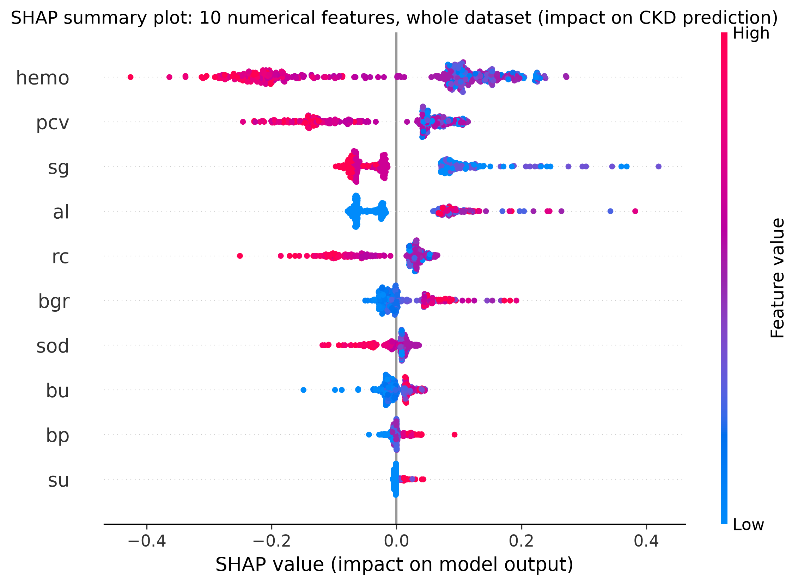
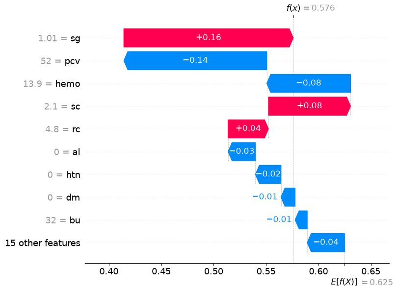

# Chronic Kidney Disease Prediction with Explainable AI

A machine learning project that predicts whether a patient has **chronic kidney disease (CKD)** from **10 numerical medical measurements**. Six classification models are tuned and compared, and the predictions are explained with **SHAP**.

## Dataset
- **Source:** [UCI Machine Learning Repository: Chronic Kidney Disease](https://archive.ics.uci.edu/dataset/336/chronic+kidney+disease) (credit to the dataset creators)
- **Size:** 400 patients (250 CKD, 150 not CKD), 24 measurements each
- The CSV is not included in this repository. Download it from the link above and save it as `kidney_disease.csv` next to the notebook.

## What the notebook does
1. **Cleaning:** removes the `id` column, fixes text and `?` values, and fills missing values with the median.
2. **Feature selection:** keeps only the **numerical** columns and picks the **top 10** by correlation with the diagnosis: `hemo, pcv, sg, rc, al, bgr, bu, sod, su, bp`.
3. **Split:** 80% training (320 patients), 20% testing (80 patients), stratified so both parts keep the same CKD ratio.
4. **Models:** KNN, SVM, Decision Tree, Naive Bayes, Logistic Regression, Random Forest. Each one is tuned with **GridSearchCV** and **5-fold cross-validation**. Models that depend on distances use a `StandardScaler` inside a `Pipeline`.
5. **Evaluation:** accuracy, precision, recall, F1, ROC AUC, confusion matrices, ROC curves, error breakdown and fold-by-fold stability.
6. **Explainability:** Random Forest feature importance, permutation importance, a decision tree plot, and SHAP.

## Results (80 hidden test patients)

| Model | Test accuracy | Recall | F1 | ROC AUC |
|---|---|---|---|---|
| SVM | 1.000 | 1.00 | 1.000 | 1.000 |
| Logistic Regression | 1.000 | 1.00 | 1.000 | 1.000 |
| Random Forest | 0.988 | 1.00 | 0.990 | 1.000 |
| KNN | 0.975 | 0.96 | 0.980 | 1.000 |
| Decision Tree | 0.975 | 0.98 | 0.980 | 0.989 |
| Naive Bayes | 0.950 | 0.92 | 0.958 | 0.985 |

5-fold cross-validation accuracy is between 0.935 and 0.988 for all models.

## Explainable AI with SHAP
**Summary plot (whole dataset):** `hemo`, `pcv`, `sg`, `al` and `rc` have the biggest impact on the model. Low hemoglobin, packed cell volume, red blood cell count and specific gravity push the prediction toward CKD, and high albumin pushes toward CKD.



**Force plot (one patient):** explains a single prediction and shows which features pushed it toward or away from CKD.



## Limitations
- The test set has only 80 patients, so scores such as 100% are not proof of a perfect model. The differences between the top models are 0 to 1 patients.
- This dataset is known to be fairly easy to separate, so these scores will not transfer directly to real clinical data.
- Missing values were filled with the median before splitting the data, which leaks a very small amount of information from the test set. A cleaner approach is to fit the median inside the pipeline on the training data only.
- This is a learning project and is **not a medical tool**.

## How to run
```bash
pip install pandas numpy matplotlib seaborn scikit-learn shap jupyter
jupyter notebook
```
Put `kidney_disease.csv` in the same folder as the notebook, open it and choose **Kernel > Restart & Run All**.

## Files
- `kidney-disease-prediction.ipynb`: the full project with outputs
- `shap_summary_whole_dataset.png`, `shap_force_plot.png`: the SHAP plots

## Author
Kishore V
Gmail : kishorevenkat987@gmail.com


